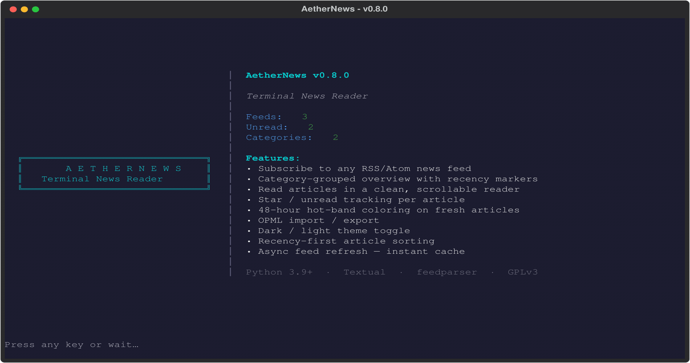

<pre align="center">
╔══════════════════════════════╗
║       A E T H E R N E W S    ║
║   Terminal News Reader       ║
╚══════════════════════════════╝
</pre>

<h1 align="center">AetherNews</h1>

<p align="center">
  <em>Terminal News Reader</em>
  <br>
  Subscribe, browse, and read news — all from your terminal.
  <br>
  <strong><em>Stay informed from the command line</em></strong>
</p>

<p align="center">
  
  
  
  
  
  
  
  
</p>

---

## Screenshots



---

## Features

- **Subscribe** to any RSS/Atom news feed
- **Category-grouped overview** — feeds organized into collapsible groups
  (`Tech`, `News`, …) with per-group unread counts; `→`/`←` or `Enter`/`Space`
  expands and collapses
- **Recency-first sorting** — articles sorted newest-first with an unread
  tiebreak (today > yesterday > older, unread floats above read)
- **48-hour hot band** — fresh article dates render bold teal; older dates dim,
  so the newest headlines jump out at a glance
- **Recently-updated markers** — `●` highlights groups and feeds with new
  content in the last 24h
- **Full-article reader** — HTML converted to clean plain text, scrollable
  (`j`/`k`/`↑`/`↓`); `f` fetches the full article body when a feed only
  provides a summary, `o` opens the original in your browser
- **Read / unread tracking** — `[ ]` unread, `[✓]` read, `[★]` starred;
  `M` marks a whole feed unread
- **Categories** — tag a feed with `c`, rename a whole category from its group
- **Starred articles** — `*` to save for later
- **TTL cache** — feeds checked within 6h are skipped on refresh; `304 Not
  Modified` bumps the freshness window, so repeat launches are fast
- **Retention** — newest ~200 articles within 30 days per feed (news is
  high-volume and short-lived; no full-history merging)
- **OPML import / export** — migrate from other RSS readers
- **Dark / light theme** toggle
- **Async feed refresh** — instant cache on startup, background updates,
  TTL-gated so feeds only refetch when stale
- **Splash screen** — branded startup with subscription stats

---

## Quick Start

### Prerequisites

- Python 3.9+

### Install

**Option 1 — pip / pipx (recommended):**
```bash
pipx install aethernews        # isolated env + on PATH (best for a CLI/TUI)
# or
pip install --user aethernews
```

**Option 2 — Makefile:**
```bash
make install           # system-wide
make install-user      # user-local, no root
```

**Option 3 — Manual venv:**
```bash
git clone https://github.com/AetherSolDev/AetherNews.git
cd AetherNews
python -m venv venv
source venv/bin/activate
pip install -r requirements.txt
pip install -e .
```

### Run

```bash
aethernews           # Launch TUI
aethernews --help    # CLI usage
aethernews list      # List subscribed feeds
```

---

## Usage

| Key | Action |
|-----|--------|
| `a` | Add feed |
| `i` / `e` | Import / export OPML |
| `u` | Refresh feeds |
| `s` | Sort feeds (newest-first ↔ subscribe order) |
| `f` | Filter feeds by name |
| `c` | Categorize a feed (or rename a category from a group) |
| `→` / `←` | Expand / collapse a category group |
| `Enter` | Browse a feed's articles |
| `Space` / `m` | Toggle read / unread |
| `M` | Mark all articles unread |
| `*` | Toggle starred |
| `n` | Jump to next unread |
| `f` | Fetch full article in reader (if only a summary) |
| `o` | Open article in browser |
| `j` / `k` | Scroll reader down / up |
| `t` | Toggle theme |
| `q` | Quit |
| `?` | Help |

---

## Data

| Data | Location |
|------|----------|
| State | `~/.local/state/aethernews/state.json` |
| Logs | `~/.local/state/aethernews/log/aethernews.log` |

Override the state path with `--data /custom/path.json`.

---

## License

[GPLv3](LICENSE) — Free as in freedom.
